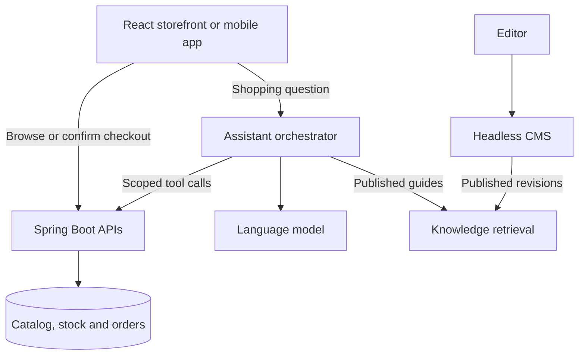

# AI-assisted headless architecture

## Q1. What does headless architecture separate, and where do microservices fit?

Draw the boundary between rendering a page, deciding a business fact and interpreting a user's request. In a traditional Spring MVC storefront the server can fetch a product, populate a model and render a Thymeleaf template in one deployment. In a headless storefront, Spring exposes the product contract to an independently deployed web frontend, a mobile app and a marketplace. A web frontend can still render HTML on the server for search indexing. A single modular backend can serve every channel. Microservices address a separate decision about backend deployment and ownership.

## Q2. How does one product read reach web and mobile clients?

A React storefront requests `GET /api/products?maxPriceMinor=8000000&currency=INR&limit=3`. Spring validates the filter and returns a bounded list of DTOs with product IDs, specifications, currency and price in minor units. For INR, 8,000,000 paise equals ₹80,000. React formats the currency and renders product cards. A mobile client consumes the same DTOs. Expose a stable representation rather than serializing JPA entities and their relationships. REST works well for a small, cacheable catalog. GraphQL can accommodate divergent channel views at the cost of query-cost controls and resolver batching.

A CMS such as Strapi, Contentful or Sanity can own editorial content and localized buying guides. Product and inventory services own price and availability. A frontend release can change the presentation independently when it honors the API contract. The cost is another network boundary, separate deployments and cache invalidation. For a single editorial site with one small team, server-rendered templates may be the cheaper choice.

## Worked system-design question

### Q3. How would you find three development laptops under ₹80,000 and help the customer buy one?

1. The orchestrator translates the request into a budget, currency and preferences. Validate the extracted filter. Run a deterministic price filter through the same catalog API as the storefront.
2. Fetch structured specifications and availability. Retrieve published guides for explanatory context. Carry product IDs and source revisions with the results. If only two items meet the budget, show those two and explain the limiting constraint.
3. Compare RAM, CPU, storage and current quoted price. Render cards linked to catalog records so a user can inspect the evidence. If the model times out, the catalog view can still display matching products.
4. On selection the order API issues a short-lived quote bound to the customer, SKU, quantity, currency and amount. Show that quote to the customer and obtain explicit confirmation. Recheck authorization, price and stock server-side. A price change or expired quote requires a fresh confirmation.
5. Submit the confirmed request with an idempotency key. Atomically record the order and its pending payment state. Use the payment provider's own idempotency support and reconcile ambiguous outcomes. If the client times out, retrieve the order by its existing key before attempting payment again.

### Q4. Where does agent orchestration belong?

A Java team can add Spring AI around a small set of Java tools. A separate Python/LangGraph service can make sense for a persisted workflow with conditional steps, retries and human review. A separate runtime adds deployment and tracing work. Start with one orchestrator. Split search, comparison or content editing into separate agents only when independent evaluation, permissions or scaling justify it. Keep ordinary browsing and checkout usable during model outages.

### Q5. How do tool calls work?

A model can propose a structured call such as `get_order_status(orderId)`. An MCP server can advertise permitted tool schemas and adapt calls to Spring APIs. The backend derives the customer from the authenticated session and checks ownership for that order. A validated tool schema alone cannot authorize access. Carry request identity across boundaries, cap tool steps and timeouts, and keep order changes behind server-enforced state transitions.

## Q6. Which other workflows can use this architecture, and how would you evaluate them?

| Workflow | Authoritative input and action | How to check the result |
|---|---|---|
| Shopping assistant | Read catalog records and compare against explicit constraints | Count over-budget recommendations and unsupported claims on a labeled query set |
| Support | Read a customer's order, check return eligibility, open a ticket when policy is ambiguous | Test cross-customer access, stale orders and human handoff |
| Content, SEO and localization | Generate a draft from approved facts, translate it and submit it to the CMS for editorial approval | Verify names, units, locale and published revision before cache invalidation |
| Campaigns and personalization | Rank approved offers using consented signals and inventory filters | Compare conversion and opt-outs in a controlled experiment |
| Operations | Summarize redacted traces and slow routes for an operator | Link each diagnosis to telemetry and measure false alarms |

## Q7. How would you test the architecture under failure and roll it out?

- Simulate a stock change between recommendation and confirmation. Expect a revised quote or out-of-stock response and zero payment attempts for the original selection.
- Replay a confirmed purchase after dropping the HTTP response. Expect the same order ID and a single payment effect. Trace the request across the assistant, order API and payment provider.
- Seed a retrieved product description with an instruction to change the amount. Treat retrieved text as evidence, scope tools by workflow, and verify that only the authoritative server quote determines the amount.
- Build the proof of concept in stages: catalog and storefront first, read-only product Q&A second, authenticated tool calls third, and persisted purchase or editorial workflows last. At every stage measure latency and failure rate. For the assistant also track grounded answers, tool success, cost per completed task and handoff rate.

## Q8. How would you summarize the design in 60 seconds?

“I would expose catalog and order capabilities from Spring Boot and let web and mobile own their presentation. For a question about development laptops, the assistant converts the budget into a validated catalog query and uses returned specifications to explain the choices. The customer sees the live quote and confirms. The order service enforces ownership, price, inventory and idempotency. I would demonstrate a price change, a lost payment response and a model outage. Those three cases show where the system gets its facts, how it avoids duplicate orders and whether customers can still shop.”
